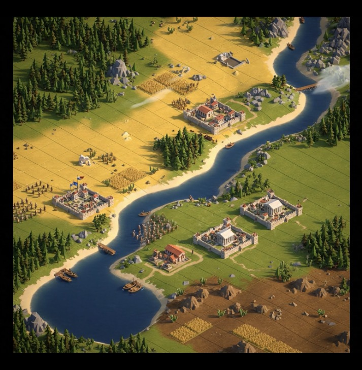
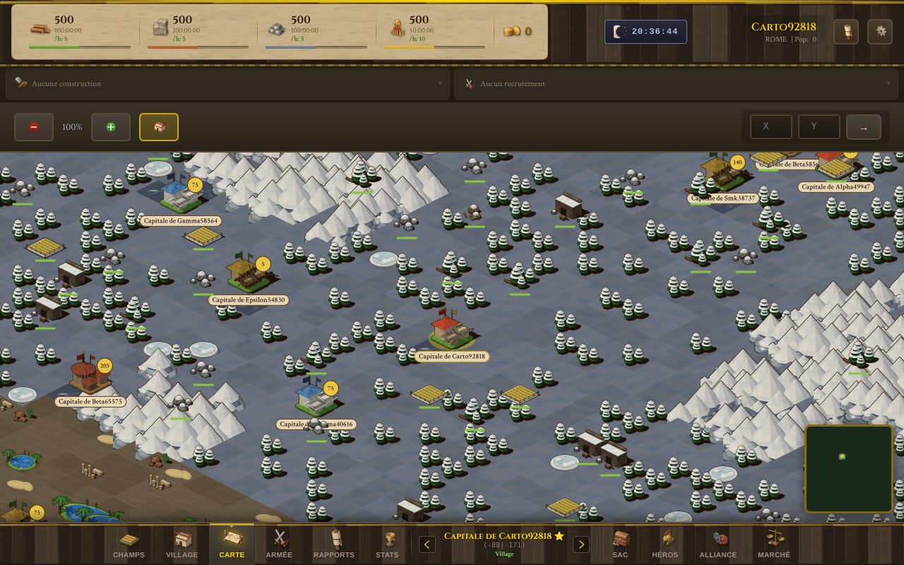
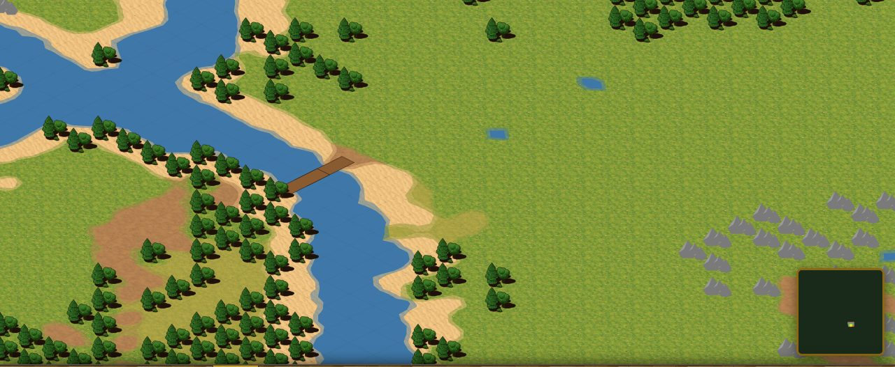
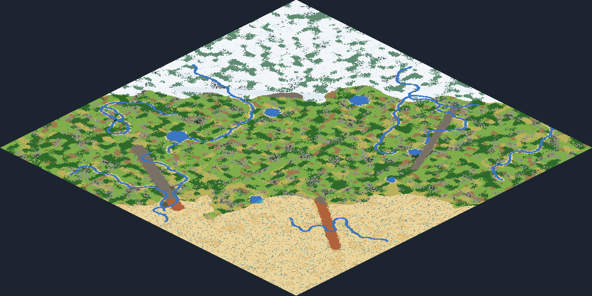
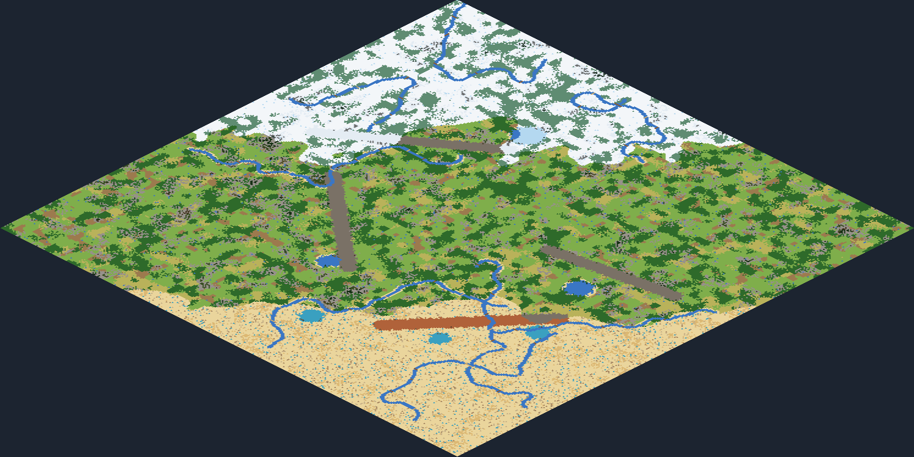
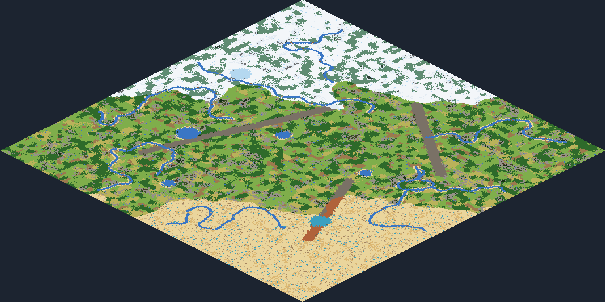

# Carte du monde : la référence et où on en est

Image de référence fournie le 25 octobre 2026 : la carte doit lui ressembler pour le **découpage**, le **gameplay** et le
**graphisme**. Seule la carte du monde change de style ; la vue de la ville et l'interface gardent le style peint.

| Référence | Avant (matin du 25 octobre) | Maintenant (dessin provisoire, en attendant les images) |
|---|---|---|
|  |  |  |

La liste des images à produire, avec les prompts prêts à coller : **[PROMPTS-CARTE.md](PROMPTS-CARTE.md)**.

## Une carte par serveur (26 octobre 2026)

Chaque serveur a sa propre carte, **tirée au hasard à sa création**. Le découpage, les règles et le style restent ceux de
la référence : neige au nord, désert au sud, tempéré ailleurs, 8 longues rivières (2 sources par bord du monde) avec ponts et
gués, 6 lacs, 4 chaînes de montagnes, forêts en massifs, rochers. Seule la disposition change d'un serveur à l'autre.

| Carte de référence (graine 0, serveur ouvert) | Une carte au hasard (graine 123456) | Une autre (graine 2147483646) |
|---|---|---|
|  |  |  |

- Tout le terrain se déduit d'une **graine** (0 à 2 147 483 646) gardée en base et publiée par `/api/world/info` ; le jeu
  dessine exactement la carte où marchent les armées. La **graine 0** est la carte de référence, gardée telle quelle pour le
  serveur déjà ouvert (au bit près : ses villes ne bougent pas).
- Un serveur neuf **ne garde que des cartes jouables** : presque toute la terre d'un seul tenant (98 à 99 % sur 150 graines
  essayées), neige et désert entre 10 et 30 % (17 à 24 % en pratique), chaque rivière traversable au moins deux fois (42 à
  62 passages par carte).
- La graine d'un monde **ne change jamais** : une autre carte demande un nouveau serveur. On peut la choisir avant
  l'ouverture (`WORLD_SEED`, aperçu avec `node tools/apercu-carte.cjs --random=4`) ; voir `docs/DEPLOIEMENT.md`.
- Les cartes au hasard n'utilisent que des calculs identiques sur tous les moteurs JavaScript (le serveur et l'iPhone ou
  Android voient la même carte, case pour case).
- Les chiffres plus bas (73 cases de pont, 33 de gué, 382 points déplacés…) sont ceux de la carte de référence.

## Décisions (25 octobre 2026)

- **Villes sur 2 × 2 cases**, comme dans l'image. Une ville secondaire se fonde sur un point de ressource dont les 3 cases
  voisines (vers le bas de l'écran) sont libres.
- **Rivières** : on les traverse par les **ponts** (vitesse normale) et les **gués** (**moitié moins vite**), placés **au hasard**
  le long de chaque rivière. Un passage est une rangée de cases d'une rive à l'autre, dans un axe de la grille.
- **Bateaux et quais** : décor seulement.
- **Biomes** : les trois du GDD, **neige au nord, désert au sud, tempéré ailleurs**.
- **Forêts** : comme le GDD, **−10 % de vitesse**, **sauf pour les Gaulois**.
- **Relief** : on garde les **chaînes de montagnes** et on ajoute les **amas de rochers** (« les deux »). Les chaînes du
  désert sont des **mesas infranchissables**, comme les montagnes ; les rochers épars du désert se contournent à pied.
- **Grille** : comme sur l'image, un quadrillage très léger, toujours visible.
- **Graphismes** : **tout en images**. Le sol est fait de **textures répétables** ; le jeu les projette en isométrique et
  découpe lui-même les fondus entre sols voisins. Cela remplace les 126 tuiles de transition prévues au départ : un outil
  d'images ne sait pas les raccorder au pixel près, alors que le jeu le fait sans couture.
- **Décor comme sur l'image** (26 octobre 2026), pas semé au hasard partout : quelques parcelles de blé de 2 × 2 cases
  autour des villes (2 à 3 cases de leurs murs, environ 6 cases par ville) et sur la terre labourée, jamais contre l'eau ;
  une meule à côté d'un champ ; un chemin de terre qui part de la porte (milieu du mur avant droit) et serpente sur 4 à
  6 cases, ou mène à un point de ressource, une lisière de forêt, une berge ou une ville voisine (96 % des villes en ont
  un ; les autres ont l'eau ou la montagne contre leur porte) ; buissons et arbres isolés au bord de l'eau, agaves sur
  l'herbe sèche, cactus et cailloux ocre au désert, quelques cailloux, buissons et cailloux givrés sous la neige.
- **Armées comme sur l'image** : une colonne de 1 à 3 groupes de soldats, le héros ou l'espion en tête, la poussière
  derrière ; **cycles de marche** peints (6 poses) par classe et par civilisation, joués pendant la marche ; les armées des
  autres joueurs marchent elles aussi le long de leur chemin, et un clic sur une armée en marche l'ouvre. La taille de la
  colonne ne trahit rien : elle suit l'effectif pour ses armées et celles de son alliance, elle est tirée au hasard pour
  les autres (l'effectif ne se lit qu'avec la Tour de guet).
- **Points de ressource comme sur l'image** (26 octobre 2026) : chacun son visuel, par ressource (camp de bûcherons,
  carrière, mine de fer, ferme, mine d'or), par terrain (tempéré, désert, neige) et par richesse (niveau 1 à 3), **sans
  couleur de civilisation** : seules les villes et les armées changent de style avec la civilisation (plus de bannière
  de civilisation sur les camps des tribus).
- **Ambiance légère, comme dans la vidéo de référence** : les bateaux glissent doucement d'avant en arrière sur l'eau en
  tanguant, quelques nuages passent lentement au-dessus de la carte (et leur ombre, à peine visible) ; la carte ne se
  redessine pour cela qu'environ 5 fois par seconde, et rien ne bouge si l'appareil demande de réduire les animations.
- **Plusieurs motifs par type de case** : 4 prairies, 3 neiges, 3 sables, 3 herbes sèches, 3 champs, 2 eaux, 2 glaces,
  mélangés par taches de quelques cases ; 3 modèles par forme de montagne (tempérée, enneigée, mesa) ; 4 forêts denses et
  3 lisières par biome (mixte, pins, feuillus, bouleaux…) ; 4 amas de rochers, 3 rochers du désert, 3 dunes, 3 ruines,
  3 palmeraies, 3 bateaux.

## Où en est chaque point

| # | Point | État | Ce qui est fait |
|---|---|---|---|
| 1 | Disposition des biomes | ✅ | Nord enneigé, sud désertique, tempéré ailleurs (≈ 20 / 20 / 60 % sur toutes les cartes), frontière qui ondule. Zone de départ des joueurs : moitié tempérée. |
| 2 | Villes sur 2 × 2 cases | ✅ | Départ, capitale déplacée, fondation, chemins, clic, surbrillance, siège, rencontres, génération des points. Aucune ville dans l'eau ni dans une poche fermée par les montagnes. |
| 3 | Rivières, ponts et gués | ✅ | 8 longues rivières de 2 à 3 cases de large ; sur la carte de référence 73 cases de pont et 33 de gué (39 passages), sur une carte au hasard 42 à 62 passages, au moins 2 par rivière ; chaque passage relie deux rives praticables. Gué = coût de marche × 2. |
| 4 | Forêts en massifs | ✅ | Massifs de plusieurs cases ; −10 % de vitesse sauf Gaulois ; la durée du trajet suit le terrain traversé (client et serveur). |
| 5 | Sol tempéré varié | ✅ | Herbe, herbe sèche (plus fréquente vers le désert), terre labourée, berges de sable au bord des rivières et des lacs ; plusieurs variantes de chaque sol mélangées par taches (en attendant leurs images, un léger voile les distingue). |
| 6 | Relief | ✅ | Montagnes gardées, amas de rochers en zone tempérée et mesas du désert (infranchissables), rochers épars du désert (franchissables). Une ville que le nouveau terrain couperait du reste de la carte est déplacée près du bord au démarrage, avec ses armées, et son propriétaire est prévenu. |
| 7 | Lacs, quais et bateaux | ✅ code, 🎨 images | Les bateaux et quais apparaissent dès que leurs images sont livrées (environ 1 case d'eau sur 80 pour un bateau, quelques quais au bord). Palmiers autour des oasis. |
| 8 | Grille | ✅ | Toujours visible, très légère, plus discrète de loin (touche G pour la masquer). |
| 12 | Décor des cases | ✅ code, 🎨 images | Champs, meules, chemins, buissons, arbres isolés, agaves, cactus, cailloux, décor givré, placés comme sur l'image ; dessin de repli en attendant les 26 images. |
| 13 | Marche des armées | ✅ code, 🎨 images | Colonnes de 1 à 3 groupes, poussière, cycles de marche peints dès leur livraison (33 images de 6 poses, guide de planche `img/guides-carte/guide-armee-planche.png`), armées des autres joueurs en mouvement. |
| 9 | Nouveau style | ✅ prompts | Style « diorama 3D stylisé » de la référence, sans contours ; référence de style : `img/carte-reference.jpg`. |
| 10 | Découpage | ✅ | Sol en textures répétables, éléments posés sans socle (losange d'une case à 50 % de la largeur, centre à 75 %), villes 2 × 2 (90 %, 68 %). Guides de cadrage dans `img/guides-carte/`. |
| 14 | Carte par serveur | ✅ | Graine tirée au hasard à la création d'un serveur, gardée en base et publiée au jeu ; graine 0 = carte de référence (serveur ouvert) ; contrôle de jouabilité ; aperçu des cartes avec `tools/apercu-carte.cjs`. |
| 11 | Liste des images et prompts | ✅ | [PROMPTS-CARTE.md](PROMPTS-CARTE.md) : 470 images par ordre de priorité (sol 20, forêts 14, rochers et montagnes 43, ponts et gués 4, désert 9, eau 5, nuages 3, décor des cases 26, villes 32, villes assiégées 120, points de ressource 45, camps 15, armées 43, ville en feu 4, marche des armées 33 images de 6 poses ; plus tard : poses du replay 38, autres effets 16), aussi en tableau `prompts-carte.csv`. |

Les points existants en base suivent le terrain au démarrage du serveur : biome recalculé, point tombé dans l'eau déplacé
sur la case libre la plus proche (sauf s'il porte une ville ou une armée). Au premier démarrage du serveur ouvert : 382 points
déplacés, 3 846 biomes mis à jour. C'est aussi pourquoi la graine d'un monde peuplé ne doit jamais changer : presque toutes
ses villes et tous ses points seraient déplacés.

## Où c'est dans le code

| Sujet | Fichier |
|---|---|
| Terrain partagé (biomes, rivières, passages, sols, coût de marche, terre ferme), tiré de la graine (`setWorldSeed`) | `frontend/js/shared/terrain.js` |
| Graine de la carte du serveur (choix au premier démarrage, `WORLD_SEED`, table `WorldConfig`) | `src/game/world.js`, `prisma/migrations/0011_world_seed` |
| Graine appliquée par le jeu (avant tout dessin, retenue pour le lancement suivant) | `frontend/js/app/01-core.js` (`applyWorldSeed`), `frontend/js/map-world.js` (`onWorldTerrainChanged`) |
| Aperçu d'une carte, choix d'une graine | `tools/apercu-carte.cjs` |
| Dessin du sol, de la grille et des éléments posés, images peintes de la carte | `frontend/js/map-world.js` |
| Villes 2 × 2 sur la carte, sprites d'avant (repli) | `frontend/js/map.js` |
| Place libre pour une ville, départ des joueurs | `src/utils/spawn.js` |
| Points de ressource (génération, mise à jour au démarrage) | `src/game/seed.js` |
| Liste des images, prompts, guides | `tools/repaint/map-world.cjs`, `tools/repaint/map-kit.cjs` |
